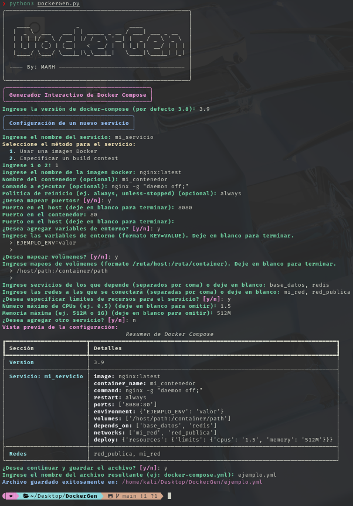

# 🐳 DockerGen

**DockerGen** es una herramienta interactiva de línea de comandos para generar archivos `docker-compose.yml` de manera guiada, validada y personalizada.
Utiliza una interfaz enriquecida con **rich** y **comprueba e instala automáticamente** sus dependencias (*rich* y *PyYAML*) si faltan.



## Características

- **Generación interactiva:** configura múltiples servicios con imagen o build (Dockerfile), nombre de contenedor, comando, política de reinicio, puertos, variables de entorno, archivos `.env`, volúmenes, dependencias, redes, healthcheck y límites de CPU/memoria.
- **Validación de cada dato:** nombres, imágenes, puertos, volúmenes, memoria, CPU y duraciones. Si algo no es válido se explica el motivo y se vuelve a preguntar, sin perder lo ya introducido.
- **Archivo siempre válido:**
  - Declara automáticamente las redes y los volúmenes con nombre.
  - Impide nombres de servicio o de contenedor repetidos y puertos del host duplicados.
  - Detecta dependencias circulares y, antes de guardar, obliga a crear (o quitar) los servicios de los que se depende.
- **Variables con `$`:** pregunta si `$VAR` debe sustituirla Docker Compose o guardarse como texto literal (`$$`), para no romper contraseñas.
- **Resumen y edición:** tras cada servicio muestra un resumen y permite añadir, rehacer o eliminar servicios antes de guardar.
- **Vista previa del YAML** con resaltado de sintaxis antes de guardarlo.
- **Manejo de archivos:** nombre por defecto, soporte de `~`, creación de carpetas y confirmación para sobrescribir.
- **Validación con Docker:** si Docker está instalado, comprueba el archivo con `docker compose config` al terminar.
- **Instalación automática de dependencias:** no es necesario instalar manualmente *rich* o *PyYAML*; DockerGen se encarga de ello (ver más abajo).
- **Formato actual de Compose** (Compose Specification, sin el campo obsoleto `version`).
- Interfaz totalmente en español (responde `s`/`n`) y salida limpia con `Ctrl+C`.

# ⚠️ Requisitos

- **Python 3.8+**
  Verifica la versión ejecutando:
```bash
python3 --version
```

### Docker y Docker Compose
Para utilizar el archivo generado necesitas Docker con **Docker Compose v2** (comando `docker compose`). No es necesario para generar el archivo.

# 🛠️ Instalación
Clona el repositorio o descarga el código fuente:

```bash
git clone https://github.com/Mayky23/DockerGen.git
cd DockerGen
```

No hace falta instalar nada más. Al ejecutarse, DockerGen comprueba que *rich* y *PyYAML* están instalados (y en la versión mínima) y, si no lo están, los instala:

1. Si ya existe un entorno virtual `.venv` junto al script (creado en una ejecución anterior), lo usa.
2. Si no, intenta instalarlos con `pip` en el Python con el que lo ejecutas.
3. Si ese Python no lo permite (por ejemplo, el Python del sistema en Debian/Ubuntu recientes, PEP 668) o no tiene `pip`, crea un entorno virtual `.venv` junto al script, instala ahí las dependencias y lo reutiliza en las siguientes ejecuciones.

Si prefieres instalarlas a mano:
```bash
pip install -r requirements.txt
```

# 🖥️​ Uso

Para iniciar DockerGen, ejecuta:
```bash
python3 DockerGen.py
```
En Linux y macOS también puedes ejecutarlo directamente con `./DockerGen.py`.

El script **no tiene parámetros**: todo se pregunta de forma interactiva. Pulsa `Enter` para aceptar el valor que aparece entre paréntesis y `Ctrl+C` para salir sin guardar.

## Formatos aceptados

| Dato | Ejemplos |
|------|----------|
| Puertos | `8080:80`, `80`, `127.0.0.1:8080:80`, `[::1]:8080:80`, `53:53/udp`, `8000-8010:8000-8010` |
| Volúmenes | `./datos:/datos`, `datos_db:/var/lib/mysql` (volumen con nombre), `/ruta/host:/ruta:ro`, `/solo/en/contenedor` |
| Variables de entorno | `CLAVE=VALOR` (una por línea) |
| Memoria | `512M`, `1G`, `1.5g`, `256MB` (mínimo 6M) |
| CPUs | `0.5`, `1`, `2` |
| Duraciones (healthcheck) | `30s`, `1m30s`, `500ms` |
| Política de reinicio | `no`, `always`, `on-failure` (con reintentos opcionales), `unless-stopped` |

## Ejemplo de archivo generado

```yaml
# Generado con DockerGen 2.0 - https://github.com/Mayky23/DockerGen
name: demo
services:
  web:
    image: nginx:1.27
    restart: unless-stopped
    ports:
      - "8080:80"
    depends_on:
      db:
        condition: service_healthy
    networks:
      - front
      - back
  db:
    image: postgres:16
    environment:
      POSTGRES_PASSWORD: pa$$word
    volumes:
      - pg_data:/var/lib/postgresql/data
    networks:
      - back
    healthcheck:
      test: ["CMD-SHELL", "pg_isready -U postgres"]
      interval: 30s
      timeout: 10s
      retries: 3
networks:
  front: {}
  back: {}
volumes:
  pg_data: {}
```

# Uso del Archivo Generado
Una vez generado el archivo docker-compose.yml, puedes usarlo con Docker Compose:

## Para iniciar los servicios:
```bash
docker compose -f docker-compose.yml up -d
```
## Para detener y eliminar los contenedores:
```bash
docker compose -f docker-compose.yml down
```
## Creador :
- [@Mayky23](https://github.com/Mayky23)

## Contribuyente :
- [@Tenvid](https://github.com/Tenvid)
